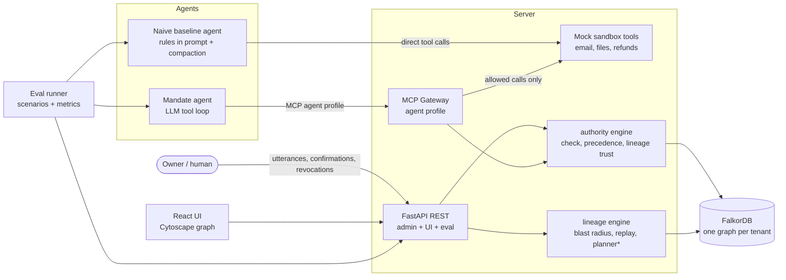

# Architecture

Status: v1.0 · Last updated 2026-10-06 · Implements [PRD.md](./PRD.md) sections 5 to 9.

## 1. Pattern and why

**A policy-enforcement gateway in front of a tool sandbox, backed by a per-tenant graph.** The decision of whether an action is allowed is made by deterministic code querying FalkorDB, never by the LLM. This is a reverse-proxy-style pattern (policy decision point plus policy enforcement point), chosen because:

- A rule that lives in a prompt can be lost; a rule enforced at the tool boundary cannot (PRD FR-13, FR-14).
- Deterministic checks are testable and reproducible, which the evaluation depends on.
- It keeps the LLM surface small: the model proposes actions, the gateway disposes.

## 2. System diagram

`*` the revocation planner is a stretch item (PRD section 9).

**Direction of data flow:** owner input flows into the graph through the REST API. Agent tool calls flow through the MCP gateway, which asks the authority engine, which reads the graph. Only an `allow` (or an approved `confirm`) reaches the sandbox. The naive baseline calls the sandbox directly, which is what makes the comparison fair and the failure visible.

## 3. Components

| Component | Responsibility | Talks to |
|---|---|---|
| `mandate.graph` | FalkorDB client, schema/index creation, query loader, per-tenant graph naming | FalkorDB |
| `mandate.authority` | `check_authority`, precedence rules, lineage-trust computation, delegation chains, deterministic instruction parser | `graph` |
| `mandate.lineage` | Blast radius, replay on a `GRAPH.COPY` clone, planner (stretch) | `graph`, `authority` |
| `mandate.gateway` | MCP server exposing the agent profile (guarded sandbox tools plus `explain_decision`); builds the Action, calls `check_authority`, executes or refuses | `authority`, `sandbox` |
| `mandate.gateway.sandbox` | Mock `email`, `files`, `refunds` tools with in-memory state | none |
| `mandate.agents` | `MandateAgent`, `NaiveAgent`, `LLMClient` interface, `AnthropicLLM`, `ScriptedLLM` | `gateway` or `sandbox`, LLM API |
| `mandate.api` | REST endpoints for admin, UI and evaluation; API-key auth | `authority`, `lineage`, `graph` |
| `mandate.eval` | Scenario loader, runner, metrics, report writer | `api`, `agents` |
| `ui/` | Graph view, split-screen run, decision explainer, blast radius and replay views | REST API |

## 4. Two MCP profiles (key design decision)

The server exposes two separate profiles on separate transports:

- **Agent profile** (given to agents): the guarded sandbox tools (`email_list`, `email_read`, `email_archive`, `email_delete`, `email_send`, `refund_issue`, `file_read`, `file_write`, `file_delete`) and `explain_decision`. **It exposes no way to create, confirm, revoke or delegate authority.**
- **Admin profile** (given to the owner's tooling only): `record_utterance`, `propose_instruction`, `confirm_instruction`, `revoke`, `delegate`, `blast_radius`, `replay_without`, `plan_revocations`.

Reason: if an agent could call `confirm_instruction`, a forged instruction could authorise itself. The agent also cannot write provenance (FR-15); the gateway writes `Action` and `Decision` nodes on its behalf.

## 5. The most important flow: a guarded tool call

1. The agent calls `email_delete(message_id="m-17")` over MCP (agent profile).
2. The gateway validates arguments (pydantic), builds an `Action {action_type: "email.delete", resource: "inbox/m-17", args}`, and stamps `at` = now (epoch ms).
3. The gateway calls `authority.check(tenant, agent_id, action, as_of=at)`.
4. The engine loads candidate instructions for the agent (directly applied, or reached through delegation chains with scope intersection), filters by scope match, validity window and revocation as of `at`, computes each instruction's `lineage_trust`, and applies precedence (data-model.md section 6).
5. The engine writes a `Decision` node with `result`, `reason`, `path_json`, and `USED` edges to the instructions that decided it, and links `Decision -[:CHECKED]-> Action`.
6. Result handling:
   - `allow`: the sandbox executes; the `Action` is marked `executed`.
   - `confirm`: the `Action` is marked `pending`, the gateway returns `confirmation_required` with an `approval_id`; nothing executes until the owner approves via `POST /v1/tenants/{tid}/actions/{aid}/approve`.
   - `deny`: nothing executes; the gateway returns the reason and a pointer to `explain_decision`.
7. Any failure in steps 2 to 5 returns `deny` with reason `check_error` (fail closed).

## 6. Technology and reasons

| Choice | Reason |
|---|---|
| Python 3.12 | Fastest path to the MCP SDK, FalkorDB client, LLM SDK and pytest in one language |
| FalkorDB (Docker) | The graph is the product: path queries, one graph per tenant, `GRAPH.COPY`, max-flow |
| `falkordb` Python client | Official client; `select_graph`, `query`, `copy` |
| `mcp` Python SDK (FastMCP) | Standard way to expose tools to any MCP-capable agent |
| FastAPI + pydantic v2 | Typed request/response models shared with the engine; automatic OpenAPI |
| React + Vite + TS + Cytoscape.js | Graph rendering with highlighted paths is the core of the demo |
| pytest + pytest-asyncio | Scenario tests and the concurrency test |
| Docker Compose | One command starts FalkorDB, API and UI |

## 7. Key trade-offs

| Decision | Chosen | Alternative | Why |
|---|---|---|---|
| Who decides allow/deny | Deterministic engine | LLM judge | Reproducible, testable, no prompt-injection path into the decision |
| Where rules live | Graph, checked at the tool boundary | Prompt or vector memory | Survives summarisation; gives an explanation path |
| Store | FalkorDB | Postgres with recursive CTEs | A relational store could model chains; the graph earns its place through lineage closure, replay by clone, per-tenant graphs and flow. See ADR-002. |
| Evaluation LLM | Deterministic `ScriptedLLM` | Always live | Reproducible numbers; live runs are a small separate set |
| Default | Deny | Allow | A wrong allow is worse than a wrong block (and false blocks are measured) |
| Delegation encoding | Edge properties for scope | A Scope node per delegation | Simpler queries; scope narrowing is checked in code |

## 8. Concurrency model

FalkorDB executes writes to a single graph serially and allows concurrent reads. The engine relies only on that documented behaviour: reads (`check`) run concurrently; writes (`Decision`, `Action`) are single small queries. Each tenant is a separate graph, so tenants do not contend. The concurrency test (evaluation.md S6) measures correctness and latency instead of assuming scalability.

## 8b. Replaceable decision engine

`authority/pdp.py` defines a `PolicyDecisionPoint` protocol (`decide(request, snapshot) -> Decision`). The v1 implementation, `DeterministicPDP`, applies the rules in [spec/authority-semantics.md](./spec/authority-semantics.md). A Cedar-backed implementation (compiling active, trusted instructions into a policy set) is possible later because both would be run against the same conformance suite (ADR-012). The pure decision function takes an in-memory snapshot of candidate data, so its latency can be measured separately from graph I/O.

## 9. Observability

- Optional OpenTelemetry tracing (`pip install ".[otel]"`): one span per `check` with attributes `tenant`, `agent`, `action_type`, `result`, `reason`, and child spans for graph queries.
- Structured JSON logs (`structlog`) with `tenant_id`, `agent_id`, `decision_id`, `latency_ms`.
- Every request gets a `request_id`, returned in the `X-Request-Id` header and stored on `Decision`.
- `/healthz` reports FalkorDB reachability.

## 10. What would change for production scale

- Replace API-key auth with per-tenant OAuth and signed instruction records (the existing projects listed in the PRD do signing).
- Persist sandbox state; connect real mail and file systems through adapters.
- Cache candidate-instruction lookups per agent with invalidation on revoke events.
- Shard tenants across FalkorDB instances; add replicas for reads.
- Move the agent loop out of the API process and queue tool executions.
- Add an append-only external audit log, since the graph can be edited by an administrator.

## 11. Assumptions

- The MCP SDK supports serving two profiles from one process on different mounts or ports (verified in Phase 4).
- `GRAPH.COPY` cost is acceptable for tenant graphs of a few thousand nodes.
